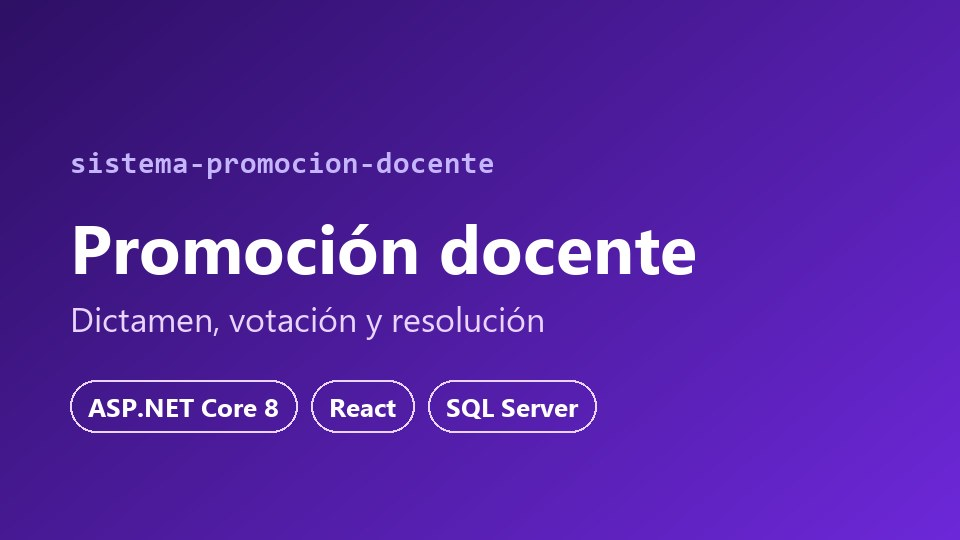

 

   

---

## 👨‍💻 Sobre mí

- 🎓 Estudio Ingeniería de Software en la Universidad Técnica de Ambato (Tungurahua, Ecuador).
- 🏗️ Construyo sistemas web y móviles de punta a punta: base de datos, API, interfaz, despliegue y documentación.
- 🌎 Mis proyectos resuelven problemas reales de organizaciones de Tungurahua: una junta de agua, un supermercado, una liga deportiva y una universidad.
- 🤝 Trabajo en equipo con Git Flow (`main`, `develop`, `feature/*`) y Conventional Commits.
- 🧪 Cuido la calidad con pruebas, integración continua y pruebas end-to-end con Playwright.
- 🔎 Busco oportunidades como Frontend Developer con TypeScript y React, abierto a roles Full Stack.

---

## 🛠️ Tecnologías

<table>
  <tr>
    <td align="center" valign="middle" width="50%">
      
    </td>
    <td align="center" valign="middle" width="50%">
      
    </td>
  </tr>
</table>

---

## 📊 Estadísticas

---

## 🐍 Contribuciones

<picture>
  <source media="(prefers-color-scheme: dark)" srcset="https://raw.githubusercontent.com/kiramman-mp3/kiramman-mp3/output/github-contribution-grid-snake-dark.svg" />
  <source media="(prefers-color-scheme: light)" srcset="https://raw.githubusercontent.com/kiramman-mp3/kiramman-mp3/output/github-contribution-grid-snake.svg" />
  
</picture>

---

## 🚀 Proyectos destacados

<table>
  <tr>
    <td align="center" valign="top" width="50%">
       
      <b><a href="https://github.com/kiramman-mp3/sistema-control-agua-riego">sistema-control-agua-riego</a></b> 
      Gestión de la Junta de Agua y Riego La Jones: lotes, turnos de riego, cobros, multas y asambleas. 
      <code>Angular · Express · MySQL</code> · <a href="https://juntalajones.com/">Demo</a>
    </td>
    <td align="center" valign="top" width="50%">
       
      <b><a href="https://github.com/kiramman-mp3/sistema-inventario-supermercado">sistema-inventario-supermercado</a></b> 
      Inventario por lotes (FEFO) y reservas con código de retiro. Web y dos apps móviles. 
      <code>Express · PostgreSQL · React · Expo</code> · <a href="https://karen.madebyjohan.xyz">Demo</a>
    </td>
  </tr>
  <tr>
    <td align="center" valign="top" width="50%">
       
      <b><a href="https://github.com/kiramman-mp3/sistema-gestion-deportiva">sistema-gestion-deportiva</a></b> 
      Gestión de la Liga Cantonal de Quero: clubes, deportistas, campeonatos, árbitros, disciplina y portal público. 
      <code>NestJS · React · PostgreSQL</code>
    </td>
    <td align="center" valign="top" width="50%">
       
      <b><a href="https://github.com/kiramman-mp3/sistema-rol-pagos-erp">sistema-rol-pagos-erp</a></b> 
      Nómina para Ecuador con reglas de ley parametrizables: IESS, décimos y horas extras. 
      <code>Angular · Express · PostgreSQL</code> · <a href="https://nomina.madebyjohan.xyz">Demo</a>
    </td>
  </tr>
  <tr>
    <td align="center" valign="top" width="50%">
       
      <b><a href="https://github.com/kiramman-mp3/sistema-gestion-aprendizaje-ia">sistema-gestion-aprendizaje-ia</a></b> 
      LMS sobre Moodle con un asistente de IA que planifica cursos desde el sílabo y responde sobre datos reales del curso. 
      <code>Moodle · NestJS · TypeScript</code> · <a href="https://lms.madebyjohan.xyz">Demo</a>
    </td>
    <td align="center" valign="top" width="50%">
       
      <b><a href="https://github.com/kiramman-mp3/sistema-promocion-docente">sistema-promocion-docente</a></b> 
      Trámite de promoción docente de la UTA con dictamen normativo, votación y resolución en PDF. 
      <code>ASP.NET Core 8 · React · SQL Server</code>
    </td>
  </tr>
</table>

---

## 📜 Certificaciones

- **IBM SkillsBuild** (2026): Front-End Web Development, Responsive Web Page Development, Back-End Development, Interactive Front-End Development, Integration of Databases y Web Application Testing and Deployment.
- **University of Helsinki** (2025): [Full Stack Open](https://studies.cs.helsinki.fi/stats/api/certificate/fullstackopen/en/16b5a0c868090bb74be4f9a32631910c), 5 ECTS.
- **Cisco** (2024): Introduction to IoT y Network Support and Security.
- **Inglés**: TOEFL ITP, ETS (2023, B1) y Suficiencia C1-, Universidad Técnica de Ambato (2024).

Todas con su credencial en mi [portafolio](https://madebyjohan.xyz/certificados) y en [LinkedIn](https://www.linkedin.com/in/johan-rodriguez-dev/details/certifications/).

---

## 📫 Contacto

Puedes ver mi trabajo y escribirme desde mi [portafolio](https://madebyjohan.xyz) o por [LinkedIn](https://www.linkedin.com/in/johan-rodriguez-dev/).

