 

  

---

## 👨‍💻 Sobre mí

- 🏗️ Construyo sistemas web y móviles de punta a punta: base de datos, API, interfaz, despliegue y documentación.
- 🌎 Mis proyectos resuelven problemas reales de organizaciones de Tungurahua: una junta de agua, un supermercado, una liga deportiva y una universidad.
- 🤝 Trabajo en equipo con Git Flow (`main`, `develop`, `feature/*`) y Conventional Commits.
- 🧪 Cuido la calidad con pruebas, integración continua y pruebas end-to-end con Playwright.

---

## 🛠️ Tecnologías

<table>
  <tr>
    <td align="center" valign="middle" width="50%">
      
    </td>
    <td align="center" valign="middle" width="50%">
      
    </td>
  </tr>
</table>

---

## 📊 Estadísticas

---

## 🐍 Contribuciones

<picture>
  <source media="(prefers-color-scheme: dark)" srcset="https://raw.githubusercontent.com/kiramman-mp3/kiramman-mp3/output/github-contribution-grid-snake-dark.svg" />
  <source media="(prefers-color-scheme: light)" srcset="https://raw.githubusercontent.com/kiramman-mp3/kiramman-mp3/output/github-contribution-grid-snake.svg" />
  
</picture>

---

## 🚀 Proyectos destacados

| Proyecto | Qué hace | Tecnologías |
|---|---|---|
| [**sistema-gestion-aprendizaje-ia**](https://github.com/kiramman-mp3/sistema-gestion-aprendizaje-ia) | LMS sobre Moodle con un asistente de IA que planifica cursos desde el sílabo y responde sobre datos reales del curso. | Moodle, NestJS, TypeScript |
| [**sistema-inventario-supermercado**](https://github.com/kiramman-mp3/sistema-inventario-supermercado) | Inventario por lotes (FEFO) y reservas con código de retiro para un supermercado. Web y dos apps móviles. [Demo](https://karen-portal.vercel.app) | Express, PostgreSQL, React, Expo |
| [**sistema-control-agua-riego**](https://github.com/kiramman-mp3/sistema-control-agua-riego) | Gestión de la Junta de Agua y Riego La Jones: lotes, turnos de riego, cobros, multas y asambleas. [Sitio](https://juntalajones.com/) | Angular, Express, MySQL |
| [**sistema-rol-pagos-erp**](https://github.com/kiramman-mp3/sistema-rol-pagos-erp) | Nómina para Ecuador con reglas de ley parametrizables (IESS, décimos, horas extras). [Demo](https://rol-pagos-ecuador.vercel.app) | Angular, Express, PostgreSQL |
| [**sistema-promocion-docente**](https://github.com/kiramman-mp3/sistema-promocion-docente) | Trámite de promoción docente de la UTA con dictamen normativo, votación y resolución en PDF. | ASP.NET Core 8, React, SQL Server |
| [**agente-proyectos**](https://github.com/kiramman-mp3/agente-proyectos) | Sistema multiagente que vigila Trello y GitHub y avisa de retrasos y bloqueos, con app móvil. | FastAPI, PostgreSQL, Expo |

---

## 📂 Todos mis repositorios

Los nombres siguen un prefijo según el tipo de proyecto: `sistema-` para aplicaciones de gestión, `web-` para sitios, `agente-` para agentes de IA y `app-` para apps móviles.

| Tipo | Repositorios |
|---|---|
| **Sistemas** | [`sistema-ecommerce-local`](https://github.com/kiramman-mp3/sistema-ecommerce-local) [`sistema-gestion-deportiva`](https://github.com/kiramman-mp3/sistema-gestion-deportiva) [`sistema-gestion-eventos-academicos`](https://github.com/kiramman-mp3/sistema-gestion-eventos-academicos) [`sistema-rastreo-buses`](https://github.com/kiramman-mp3/sistema-rastreo-buses) [`sistema-alquiler-vehiculos`](https://github.com/kiramman-mp3/sistema-alquiler-vehiculos) |
| **Web** | [`web-portafolio-personal`](https://github.com/kiramman-mp3/web-portafolio-personal) [`web-portal-investigacion`](https://github.com/kiramman-mp3/web-portal-investigacion) [`web-wiki-minecraft`](https://github.com/kiramman-mp3/web-wiki-minecraft) [`web-scrollytelling-facturas`](https://github.com/kiramman-mp3/web-scrollytelling-facturas) |
| **Agentes y apps** | [`agente-atencion-cursos`](https://github.com/kiramman-mp3/agente-atencion-cursos) [`app-calculadora-emergencia`](https://github.com/kiramman-mp3/app-calculadora-emergencia) |

---

## 📫 Contacto

Puedes ver mi trabajo y escribirme desde mi [portafolio](https://johandev-portafolio.vercel.app).

