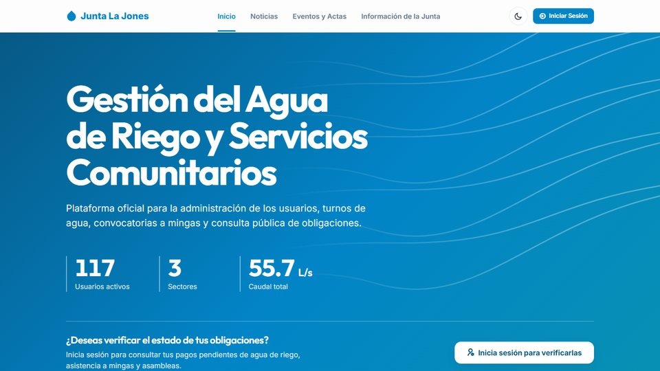
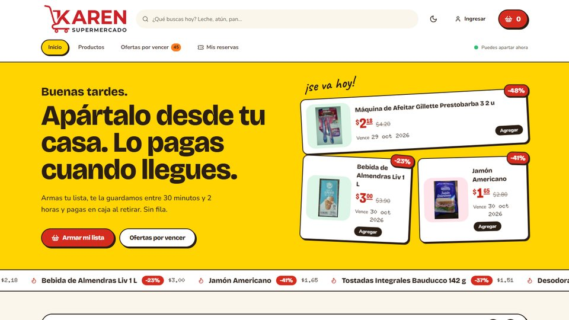
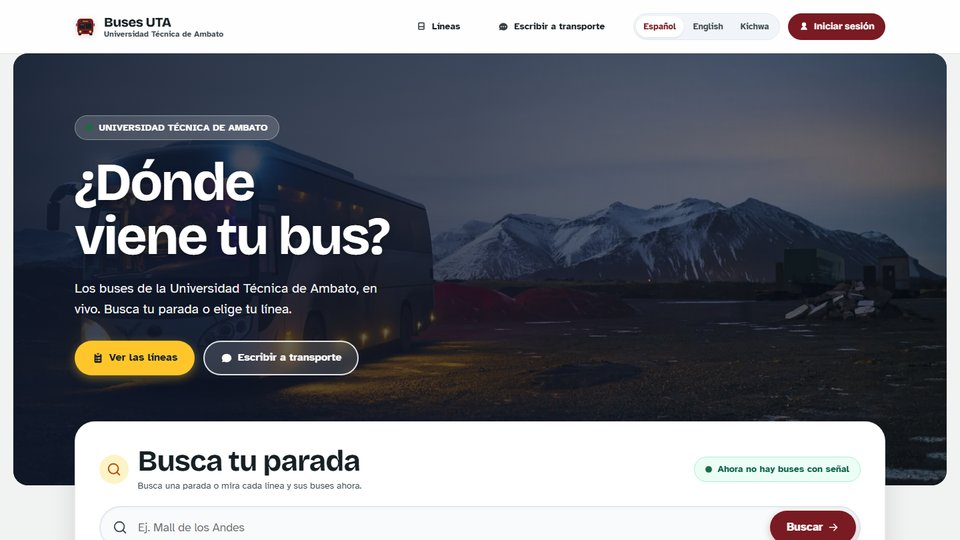
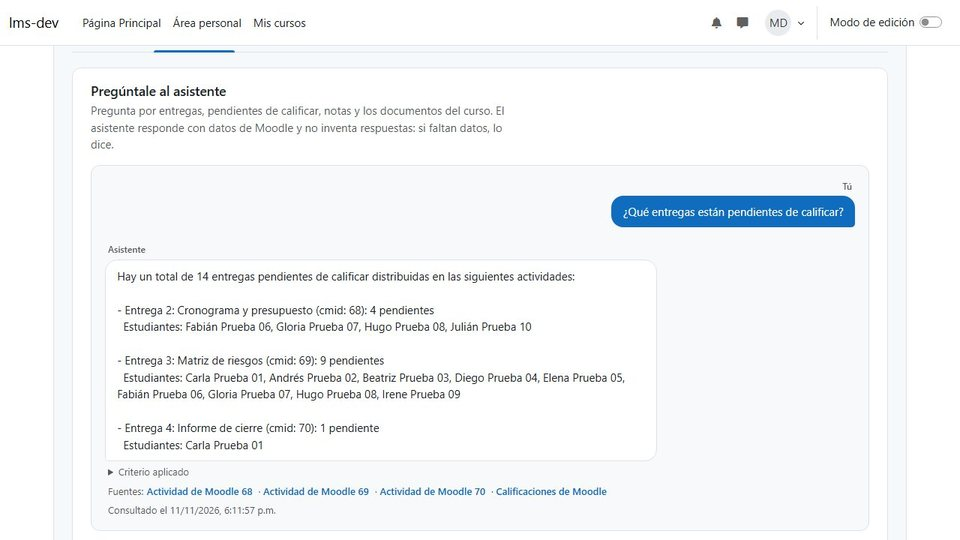
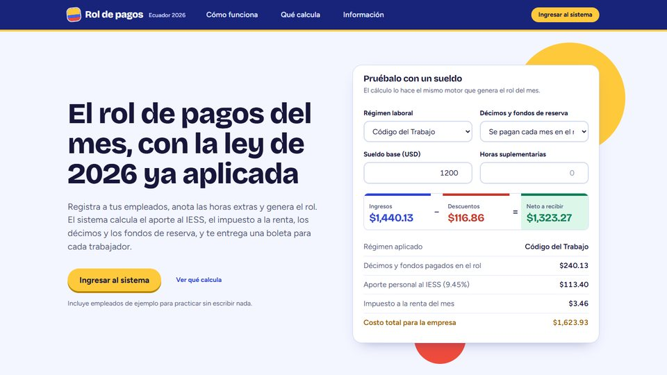
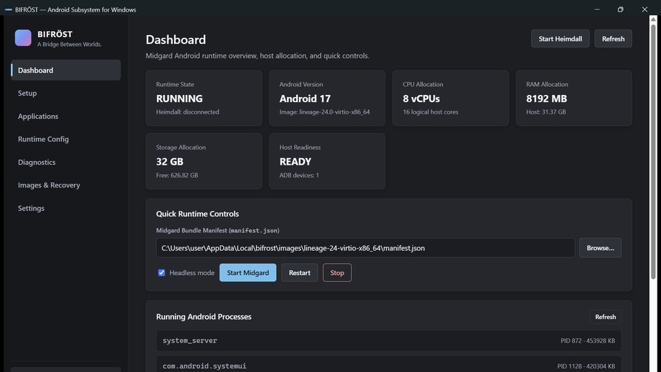

### Johan Rodríguez

Full Stack developer · TypeScript (Angular, React, Node.js) · Ambato, Ecuador

I build systems that real organizations in Tungurahua use: a water and irrigation board, a supermarket and a sports league. I work with TypeScript end to end, write tests and CI from the start, and deploy to my own server.

[Portfolio](https://madebyjohan.xyz) · [English](https://madebyjohan.xyz/en) · [LinkedIn](https://www.linkedin.com/in/johan-rodriguez-dev/) · [CV (PDF)](https://madebyjohan.xyz/cv-johan-rodriguez-es.pdf)

---

#### Experience

- **Junta de Agua y Riego La Jones** (Aug 2026 – present): tech lead of a team of 10. A web system that replaced the shift and payment notebooks: 150 users and 4 board members, approved after training. [juntalajones.com](https://juntalajones.com/)
- **Supermercado Karen** (Sep 2026 – present, freelance): tech lead in a team of 4. Batch inventory with FEFO, reservations with pickup codes and three apps, in a full pilot at the store.
- **Liga Cantonal de Quero** (volunteer): sports management platform in development, with tests and CI from day one. Launch in 2027.

#### Featured projects

<table>
  <tr>
    <td valign="top" width="50%">
       
      <b><a href="https://github.com/kiramman-mp3/sistema-control-agua-riego">Junta de Agua La Jones</a></b> · <a href="https://juntalajones.com/">live</a> 
      Irrigation shifts, community work with fines, payments with PDF receipts and a member portal. Playwright and CI. 
      <code>Angular · Express · MySQL</code>
    </td>
    <td valign="top" width="50%">
       
      <b><a href="https://github.com/kiramman-mp3/sistema-inventario-supermercado">Supermercado Karen</a></b> · <a href="https://karen.madebyjohan.xyz">live</a> 
      FEFO inventory with expiry alerts, reservations with pickup codes, a web portal and two mobile apps. 
      <code>Express · PostgreSQL · React · Expo</code>
    </td>
  </tr>
  <tr>
    <td valign="top" width="50%">
       
      <b><a href="https://github.com/kiramman-mp3/sistema-rastreo-buses">UTA bus tracking</a></b> · <a href="https://buses.madebyjohan.xyz">live</a> 
      Tech lead (team of 2). Odoo 16 module with Traccar: live map, routes, stops and a driver tablet app. 
      <code>Python · Odoo · PostgreSQL · React Native</code>
    </td>
    <td valign="top" width="50%">
       
      <b><a href="https://github.com/kiramman-mp3/sistema-gestion-aprendizaje-ia">LMS with an AI assistant</a></b> · <a href="https://lms.madebyjohan.xyz">live</a> 
      Tech lead (team of 3). Moodle 5.1 with an assistant that plans the course from the syllabus and answers using real data. 
      <code>NestJS · TypeScript · Moodle</code>
    </td>
  </tr>
  <tr>
    <td valign="top" width="50%">
       
      <b><a href="https://github.com/kiramman-mp3/sistema-rol-pagos-erp">Ecuador payroll</a></b> · <a href="https://nomina.madebyjohan.xyz">live</a> 
      Configurable labor rules: employment regimes, minimum wage, 13th/14th salaries, overtime and IESS. 
      <code>Angular · Express · PostgreSQL</code>
    </td>
    <td valign="top" width="50%">
       
      <b><a href="https://github.com/kiramman-mp3/bifrost">BIFRÖST</a></b> 
      Android subsystem for Windows 11 in Rust and Tauri. Built openly with AI assistance: spec, review, tests and CI. 
      <code>Rust · Tauri · WHPX · AOSP</code>
    </td>
  </tr>
</table>

More projects, including early ones, at [madebyjohan.xyz/proyectos](https://madebyjohan.xyz/proyectos).

#### Homelab

I host my projects on my own server: Docker Compose behind Cloudflare Tunnel (`*.madebyjohan.xyz`). A deploy script checks `main` every 5 minutes, rebuilds, runs a health check and rolls back if it fails.

#### How I work

Every change goes through a pull request with CI green, using Conventional Commits. Unit tests, plus Playwright end to end where it matters. I document technical decisions as ADRs.

#### Education

Software Engineering at Universidad Técnica de Ambato (2027). Full Stack Open (University of Helsinki), IBM SkillsBuild. English C1-.
